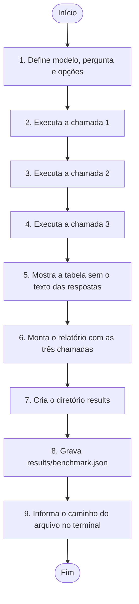
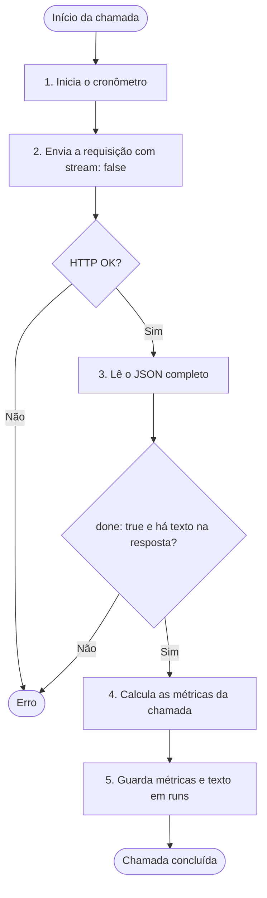

# Fluxo de `benchmark.mts`

O arquivo faz três requisições com `stream: false`, uma após a outra. Guarda o resultado de cada chamada e grava um relatório JSON.

## Fluxo principal

Os passos 2, 3 e 4 correspondem às três iterações do `for`. Cada chamada precisa terminar antes de começar a próxima. Se uma delas lançar um erro, os passos seguintes não são executados.

## O que acontece em cada chamada (passos 2, 3 e 4)

As métricas guardadas são `clientMs`, `loadMs`, `inputTokens`, `outputTokens`, `tokensPerSecond` e `doneReason`. O campo `answer` guarda o texto da resposta. A tabela omite `answer`, mas o relatório JSON inclui esse campo. O caminho `results/benchmark.json` é relativo ao diretório de execução.
