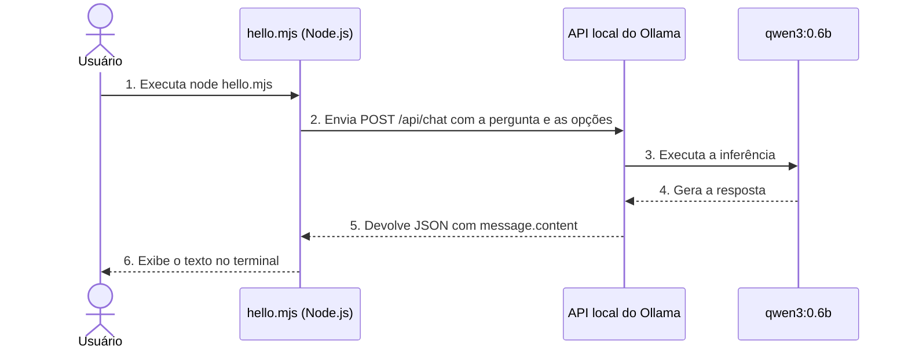

# Executando minha primeira LLM local com JavaScript

Neste exemplo, executo um modelo de linguagem no computador com o Ollama. O arquivo `hello.mjs` usa JavaScript para enviar uma pergunta ao modelo e mostrar a resposta no terminal.

## Preparando o ambiente

### Instalando o Node.js

Comecei pelo Node.js, que permite executar o arquivo JavaScript pelo terminal. A versão LTS está disponível na [página oficial do Node.js](https://nodejs.org/en/download).

Para conferir a instalação, usei no terminal:

```bash
node --version
```

### Instalando o Ollama

Em seguida, instalei o Ollama, que executa o modelo localmente e disponibiliza a API usada pelo exemplo. A [página oficial de instalação do Ollama](https://ollama.com/download) traz as instruções para cada sistema operacional.

Para conferir a instalação, usei:

```bash
ollama --version
```

O Ollama precisa estar em funcionamento durante o experimento para que a API local esteja disponível.

### Baixando o modelo

Escolhi o modelo `qwen3:0.6b` para este exemplo e fiz o download com:

```bash
ollama pull qwen3:0.6b
```

Para confirmar que ele aparecia entre os modelos instalados, usei:

```bash
ollama list
```

### Executando o exemplo

No terminal, a partir da raiz deste repositório, entrei na pasta do exemplo e executei o arquivo:

```bash
cd local-llm-lab
node hello.mjs
```

O terminal mostra a resposta do modelo à pergunta definida em `hello.mjs`.

## Fluxo da execução

O diagrama mostra o caminho da pergunta até a resposta exibida no terminal:



## Entendendo como funciona a requisição

O endereço `http://localhost:11434/api/chat` aponta para o serviço do Ollama no computador em que executei o exemplo.

O endpoint `/api/chat` recebe mensagens de uma conversa. Neste primeiro experimento, enviei apenas uma:

```javascript
messages: [
  {
    role: "user",
    content: "Explique o que é uma LLM em duas frases.",
  },
]
```

O campo `model` informa qual modelo instalado deve responder:

```javascript
model: "qwen3:0.6b"
```
Esse campo seleciona o modelo, mas não faz o download automaticamente neste exemplo.

- `role` identifica o papel da mensagem.
- `user` indica que a mensagem veio do usuário.
- `content` contém o texto enviado ao modelo.

### Por que usei `stream: false`?

Uma resposta pode ser recebida gradualmente, à medida que o modelo gera o texto. Esse comportamento é chamado de **streaming**.

Para começar, escolhi receber a resposta completa de uma vez:

```javascript
stream: false
```

Isso permite receber a resposta completa em JSON e convertê-la em um objeto JavaScript:

```javascript
const result = await response.json();
```

Em um próximo experimento, poderei usar streaming para acompanhar a geração e medir o tempo até o primeiro conteúdo recebido.

### Por que usei `think: false`?

O modelo escolhido oferece um modo de *thinking*, no qual gera uma etapa de raciocínio antes da resposta final. No Ollama, essa etapa pode aparecer em `message.thinking`, separada da resposta em `message.content`. Neste exemplo, desativei esse modo:

```javascript
think: false
```

Assim, mantenho o primeiro experimento focado na resposta final. Esse parâmetro depende do suporte do modelo e não deve ser considerado universal para qualquer LLM.

### Por que limitei o contexto e a geração?

Estes dois parâmetros controlam limites diferentes:

```javascript
options: {
  num_ctx: 2048,
  num_predict: 128,
}
```

`num_ctx` define o tamanho da janela de contexto configurada para a execução. Essa janela precisa acomodar a entrada e a geração.

`num_predict` limita quantos tokens o modelo pode gerar.

Tokens são unidades usadas pelo modelo para processar texto. Um token não corresponde necessariamente a uma palavra: uma palavra pode ser dividida em vários tokens.

Escolhi valores modestos para começar com perguntas curtas. Não precisei configurar a maior janela suportada pelo modelo para executar esse exemplo.

## Entendendo a resposta

O Ollama devolve um JSON com o texto gerado e informações sobre a execução. Para inspecionar o objeto obtido com `response.json()`, posso substituir a última linha do arquivo por:

```javascript
console.log(result);
```

Para apresentar apenas a resposta, usei:

```javascript
console.log(result.message.content);
```

Isso separa o **objeto obtido do corpo da resposta HTTP** com `response.json()` do **texto gerado pelo modelo**, que está em `result.message.content`.

Uma requisição bem-sucedida comprova que a integração funciona. Ela não garante que a explicação produzida pelo modelo esteja correta.

## Alterando a pergunta

Para experimentar outra entrada, posso alterar somente o `content`:

```javascript
content: "Qual é a diferença entre um modelo de IA e uma API?"
```

Depois da alteração, executo novamente:

```bash
node hello.mjs
```

Cada execução desse arquivo envia uma nova requisição com uma única mensagem. **O programa ainda não mantém uma conversa.**

Se eu perguntar “pode explicar melhor?” em uma nova execução, o código não enviará a pergunta anterior. Para manter uma conversa, a aplicação precisa incluir o histórico nas mensagens — um assunto para um próximo experimento.

## Se algo não funcionar

Se aparecer um erro de conexão, verifico se o Ollama está em funcionamento.

Se o erro indicar que o modelo não foi encontrado, confiro o nome usado no código e os modelos instalados:

```bash
ollama list
```

Se necessário, baixo a tag correta:

```bash
ollama pull qwen3:0.6b
```

A primeira resposta pode demorar mais porque o Ollama precisa carregar o modelo.

Para verificar quais modelos estão carregados, uso:

```bash
ollama ps
```

Para liberar o modelo da memória depois de terminar, uso:

```bash
ollama stop qwen3:0.6b
```

Esse comando descarrega o modelo, mas mantém os arquivos baixados no disco.

## O que construí até aqui

Uma aplicação pequena que envia uma mensagem por HTTP, solicita uma inferência local e apresenta o texto gerado.
