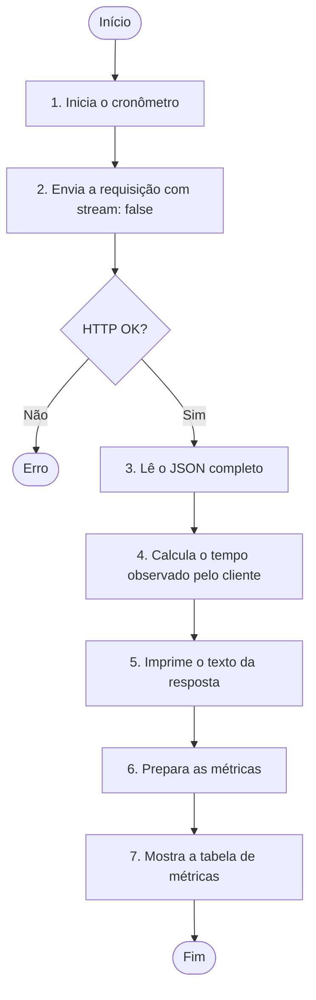
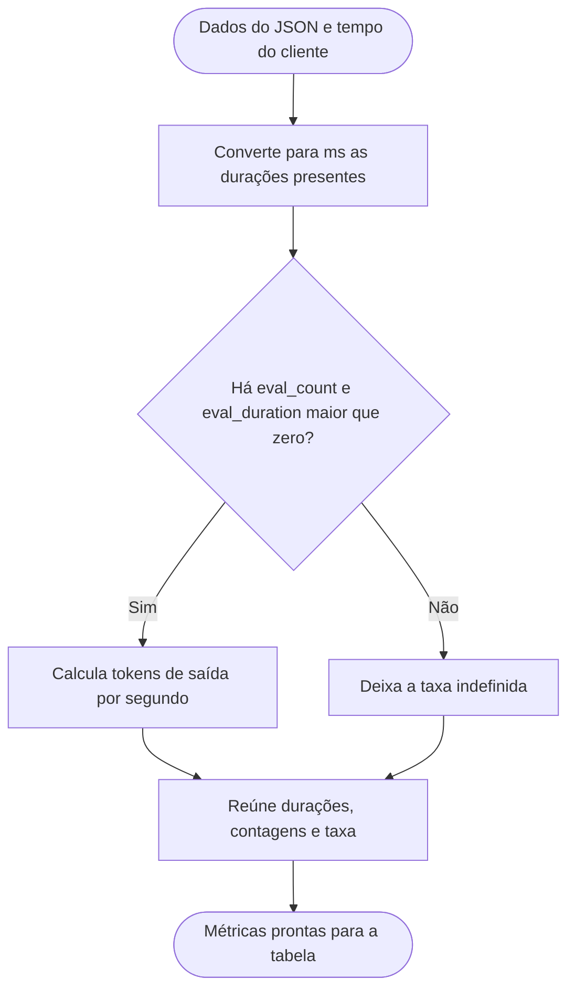

# Medindo uma resposta de LLM local com TypeScript

Neste experimento, partimos do ambiente preparado no [primeiro exemplo](HELLO.md) e usamos `metrics.mts` para enviar uma pergunta ao Ollama e observar quanto tempo a resposta levou. Além do tempo medido pelo próprio programa, mostramos as durações e as contagens de tokens devolvidas pela API. Assim, conseguimos distinguir o tempo observado pelo cliente das etapas informadas pelo servidor.

## Executando o exemplo

Com o Ollama em funcionamento, vamos entrar na pasta do exemplo a partir da raiz do repositório e executar o arquivo TypeScript:

```bash
cd local-llm-lab
npx tsx metrics.mts
```

O terminal mostra primeiro o texto gerado e depois uma tabela com os tempos, as contagens de tokens e a velocidade de geração. Os valores variam entre execuções, mesmo com a mesma pergunta.

## Fluxo da execução



O cronômetro começa imediatamente antes do `fetch` e para depois que o programa lê o JSON completo. Por isso, o tempo observado pelo cliente inclui a espera pela resposta e a leitura do corpo. O arquivo verifica o status HTTP, mas não verifica o campo `done` antes de imprimir a resposta.

## Entendendo a requisição

Assim como em `hello.mjs`, enviamos uma mensagem para `http://localhost:11434/api/chat` usando o modelo `qwen3:0.6b`. Mantemos `stream: false` para receber um único JSON com o texto e as métricas ao final da geração:

```typescript
stream: false,
think: false,
keep_alive: "5m",
options: {
  num_ctx: 2048,
  num_predict: 128,
  temperature: 0,
}
```

- `think: false` - desativa o modo de *thinking* para este modelo.
- `num_ctx` - configura a janela de contexto.
- `num_predict` - limita a geração a 128 tokens.
- `temperature: 0` - reduz a variação da geração, mas não garante tempos ou respostas idênticos.
- `keep_alive: "5m"` - pede ao Ollama que mantenha o modelo carregado por cinco minutos após a requisição. Uma execução com o modelo já carregado pode ter um tempo de carregamento menor que a primeira.

## Medindo o tempo no cliente

Utilizamos o `performance.now()` antes de enviar a requisição e novamente depois de converter o corpo da resposta em objeto:

```typescript
const start = performance.now();
// Envia a requisição e lê o JSON completo.
const clientDurationMs = performance.now() - start;
```

A diferença já está em milissegundos. Ela representa o tempo observado por este programa para obter a resposta completa. Não é uma medida do tempo até o primeiro token: com `stream: false`, o texto só chega quando a resposta está pronta.

## Vamos entender as métricas da resposta

O Ollama informa durações em **nanossegundos**. Para mostrar milissegundos, o programa divide cada duração por `1.000.000` e arredonda para duas casas decimais. A tabela reúne:

| Métrica exibida | Origem | O que representa |
| --- | --- | --- |
| Tempo observado pelo cliente (ms) | `performance.now()` | Intervalo entre o início da requisição e a leitura completa do JSON pelo programa. |
| Tempo reportado pelo servidor (ms) | `total_duration` | Duração total da requisição informada pelo Ollama. |
| Carregamento do modelo (ms) | `load_duration` | Tempo gasto para carregar o modelo. |
| Processamento da entrada (ms) | `prompt_eval_duration` | Tempo gasto para processar os tokens de entrada. |
| Geração da resposta (ms) | `eval_duration` | Tempo gasto para gerar os tokens de saída. |
| Tokens de entrada | `prompt_eval_count` | Quantidade de tokens processados na entrada. |
| Tokens de saída | `eval_count` | Quantidade de tokens gerados na resposta. |
| Tokens de saída por segundo | `eval_count` e `eval_duration` | Taxa calculada para a etapa de geração. |

O tempo do cliente e `total_duration` podem ser diferentes: são medidos em lados distintos da requisição. Os tempos das etapas ajudam a investigar onde houve demora, mas não precisam somar exatamente o tempo observado pelo cliente.

### Como calculamos a velocidade de geração

Para obter tokens de saída por segundo, dividimos a contagem de tokens gerados pela duração da geração em segundos:

```text
tokens de saída por segundo = eval_count / (eval_duration / 1.000.000.000)
```

O programa só calcula essa taxa quando `eval_count` e `eval_duration` estão presentes e a duração é maior que zero. Se faltar algum desses dados, a taxa fica indefinida. Ela descreve apenas a etapa de geração; não inclui carregamento do modelo, processamento da entrada ou comunicação com o cliente.

### Preparação da tabela



O código trata as durações e contagens do JSON como opcionais. Quando uma duração não vem na resposta, a função de conversão também devolve `undefined`, sem inventar um valor para a tabela.

## Interpretando uma execução

Uma única chamada mostra o comportamento daquela execução. Se o modelo precisou ser carregado, `load_duration` pode representar uma parte relevante do tempo total. Em chamadas seguintes, com o modelo ainda em memória, esse valor pode diminuir. Também podem variar a carga do computador, a quantidade de tokens gerados e os tempos medidos.

Para comparar execuções, mantemos a mesma pergunta, o mesmo modelo e as mesmas opções. Mesmo assim, evitamos concluir que uma configuração é mais rápida com base em apenas uma chamada. O arquivo `metrics.mts` faz uma requisição por execução e não calcula médias.

## Alterando a pergunta

Podemos mudar o campo `content` em `metrics.mts` e executar o arquivo novamente:

```typescript
content: "Qual é a diferença entre um modelo de IA e uma API?",
```

```bash
npx tsx metrics.mts
```

Uma pergunta diferente pode alterar a quantidade de tokens de entrada e de saída e, com isso, os tempos observados. Cada execução envia uma única mensagem; o programa não mantém o histórico de uma conversa.

## Se algo não funcionar

Se aparecer um erro de conexão, verificamos se o Ollama está em funcionamento. Se o modelo não for encontrado, conferimos se `qwen3:0.6b` aparece entre os modelos instalados:

```bash
ollama list
```

Se a primeira execução demorar mais, verificamos se o modelo estava carregado:

```bash
ollama ps
```

## O que construímos até aqui

Uma aplicação pequena que faz uma inferência local e mostra o texto gerado junto com métricas de tempo e tokens. Ela permite observar uma execução e entender de onde vêm os números exibidos no terminal.
