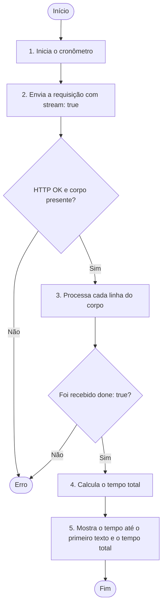
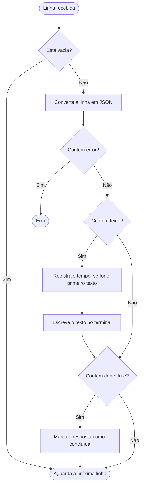

# Fluxo de `stream.mts`

O arquivo envia uma requisição com `stream: true` e lê a resposta linha por linha. Os diagramas abaixo mostram o fluxo principal e o processamento de cada linha.

## Fluxo principal

O passo 3 se repete até o corpo da resposta terminar. Receber `done: true` marca a conclusão, mas não interrompe a leitura.

## Processamento de cada linha (passo 3)

O tempo até o primeiro texto é contado desde antes do `fetch`. Se nenhuma linha trouxer `done: true`, o arquivo lança um erro ao fim da leitura.
